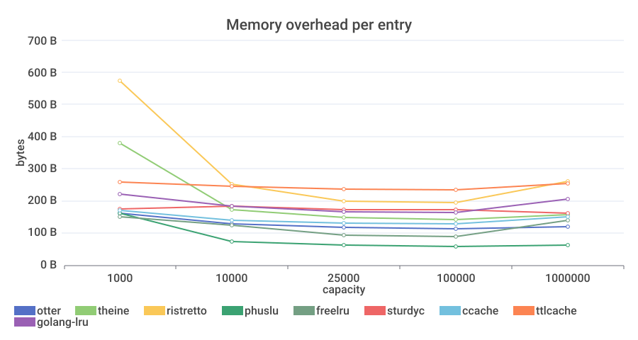
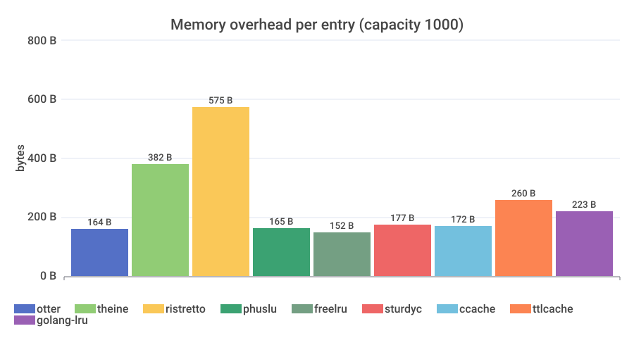
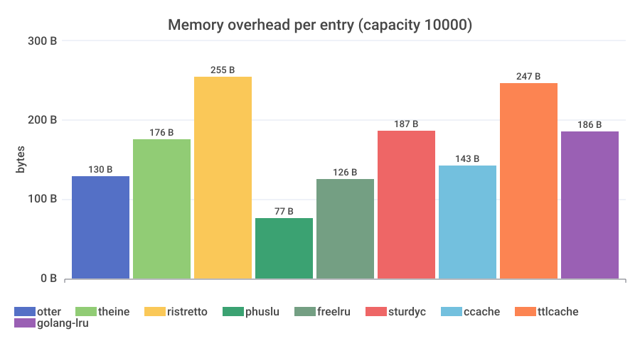
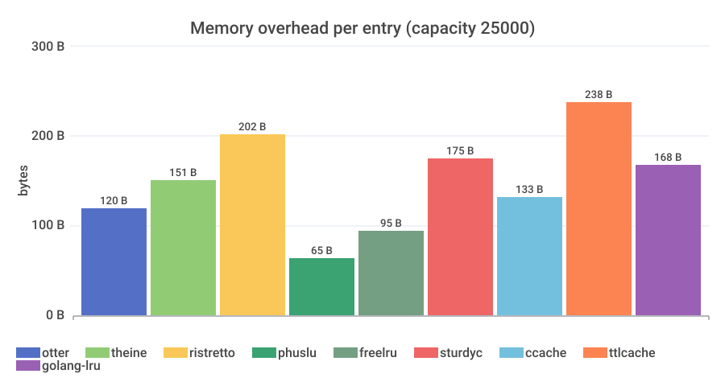
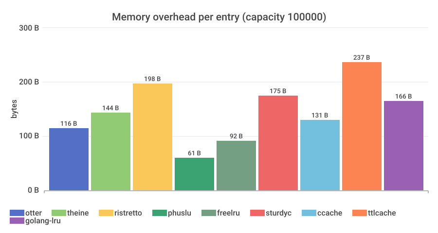
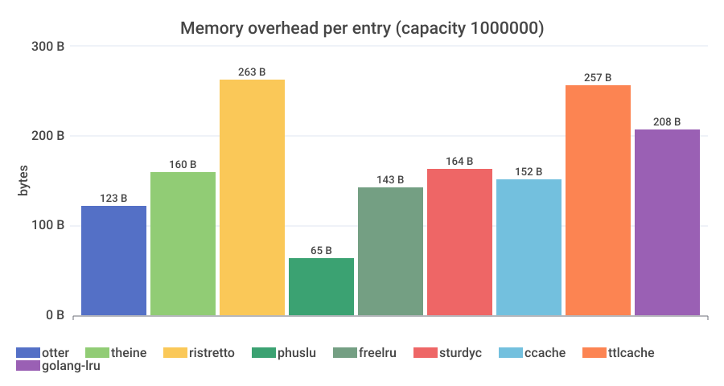

# Memory consumption

### Description

This benchmark fills a cache to its capacity with 32-byte keys and measures how much memory the cache itself needs per entry. Keys and values are allocated before the measurement starts, and the heap is measured after a garbage collection on both sides, so neither the payload nor the garbage left from filling the cache is counted. Every cache runs in its own process with a 1 hour expiration, which is how most caches are used.

Some caches keep fewer entries than their capacity: phuslu/lru and go-freelru split the capacity between shards, and sturdyc evicts in batches. The charts show the memory per entry the cache actually kept, so keeping fewer entries doesn't make a cache look smaller.

The source code can be found [here](https://github.com/maypok86/otter/tree/main/benchmarks/memory).

### All capacities

### By capacity

=== "1,000"

    

=== "10,000"

    

=== "25,000"

    

=== "100,000"

    

=== "1,000,000"

    

### Conclusion

phuslu/lru needs the least memory: 61–77 bytes per entry from 10,000 entries up. It keeps entries in arrays instead of separate objects, which pays off most with small entries like these. It keeps 92–99.5% of its capacity, because every shard has its own limit.

Otter needs 116–130 bytes per entry from 10,000 entries up, the least among the caches with a policy smarter than LRU, even though it also keeps read and write buffers. go-freelru needs less than otter between 10,000 and 100,000 entries, and more at a million.

Ristretto needs the most memory at 1,000 and 10,000 entries, because it is configured, as its docs recommend, with 10 admission counters per entry.

Ristretto also doesn't store keys: it keeps two 64-bit hashes of a key instead. This benchmark doesn't show the saving, because the keys are allocated before the measurement and other caches only keep a reference to them. With large keys the difference shows up: the other caches keep every key alive, and ristretto doesn't. The price is collisions: two keys with the same pair of hashes are treated as the same key. That is rare with the default hash function, but when it happens, `Get` returns the value of another key.
